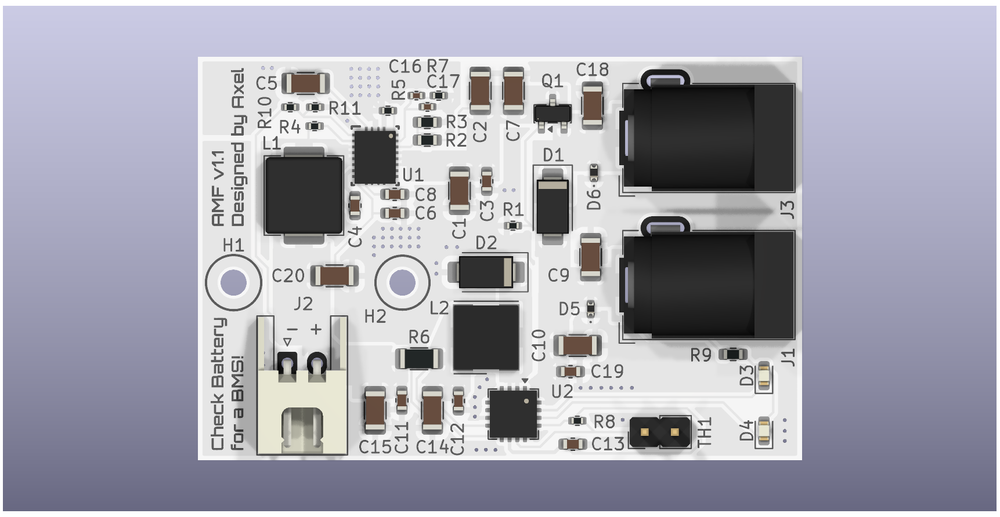

# AMF: "A Modem's Fellow"

A simple uninterruptible power supply (UPS) project for low-voltage appliances.

## Specifications

| Parameter | Minimum | Nominal | Maximum | Notes |
| :--- | :---: | :---: | :---: | :--- |
| Input Voltage | 9V | 12V | 15V | None |
| Output Voltage | 9V | 12V | 12.6V | Step-up output voltage can be regulated by changing `R2`/`R3` |

* **Charger IC:** [TP5100](https://cdn.hackaday.io/files/1948598336847456/TP5100-ENG.pdf)
* **Main Step-Up Converter:** [TPS61088](https://www.ti.com/lit/ds/symlink/tps61088-q1.pdf)

### Absolute Maximum Ratings

| Rating | Limit | Notes |
| :--- | :---: | :--- |
| Input Voltage | 20V | See Note 1 |
| Output Voltage | 14.5V | See Note 2 |
| Output Current | 3A | None |
| Battery Current | 10A | None |

> **Warning:** Stresses beyond those listed under Absolute Maximum Ratings may cause permanent damage to the device.

> **Battery Protection Notice:** This board does not include integrated cell balancing or over-discharge protection. Any connected 2S Li-Ion battery pack **must** have a proper Battery Management System (BMS) with cell balancing and protection circuitry. Operating an unprotected pack risks overcharging, over-discharging, permanent cell damage, or fire.

> **NTC Thermistor Notice:** Connect an NTC thermistor for thermal monitoring. If an NTC thermistor is not used, short the NTC connection with a 0-ohm resistor (or a piece of wire). It is also recommended to desolder `R8`.

**Note 1:** Supplying voltage higher than 20V may cause:
1. Permanent MOSFET (`AO3407A`) gate oxide layer damage
2. Permanent damage to the charger IC (`TP5100`)
3. **Potential life-threatening fire and/or explosion of the connected Li-Ion battery**

**Note 2:** Supplying voltage into the *Output* connector may cause a backpowering event, which can lead to:
1. Permanent MOSFET (`AO3407A`) gate oxide layer damage
2. Permanent damage to the step-up converter (`TPS61088`)
3. **Potential life-threatening fire and/or explosion of the connected Li-Ion battery**

## Current Features

1. Automatic switchover (**NIPM™**) to the battery if the input voltage drops near 0V.
2. Dedicated 8.4V (2S) pack charger (`TP5100`, 1A) — *requires an external BMS with cell balancing on the battery pack*.
3. Charging indication.

## TODO

1. Better switchover circuitry with a proper `Vref`.
2. 1.27mm I/O header to communicate with an MCU.

## NIPM™: "Not Intellectual Power Manager"

### Operation Description

* **When 12V input is present:**
  * The P-channel MOSFET (`AO3407A`) is OFF, isolating the `TPS61088` from the output.
  * The diode (`SS34`) is forward-biased, allowing current to pass almost directly from the 12V input jack to the load.

* **When 12V input is missing:**
  * The P-channel MOSFET gate is pulled down by `R1` (10kΩ), connecting the battery path to the load.
  * The diode is reverse-biased, blocking current from leaking back into the 12V input line.

## Misc
* **Images of the PCB sit at `/Images/`**
* **You can have a look at the schematic, it's in `Schematic.pdf` file**

## Legal

This project is published under the MIT License. See the `LICENSE` file for the full license notice.

Fonts, footprints, symbols, and other third-party files are published under their respective licenses.

THE PROJECT IS PROVIDED "AS-IS", WITHOUT WARRANTY OF ANY KIND, EXPRESS OR IMPLIED, INCLUDING BUT NOT LIMITED TO THE WARRANTIES OF MERCHANTABILITY, FITNESS FOR A PARTICULAR PURPOSE AND NONINFRINGEMENT.
